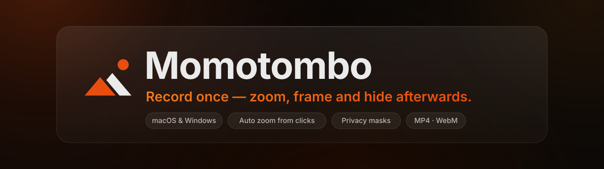
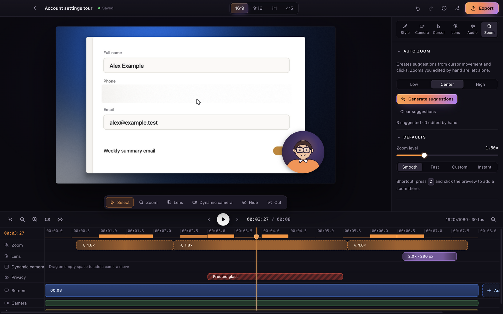
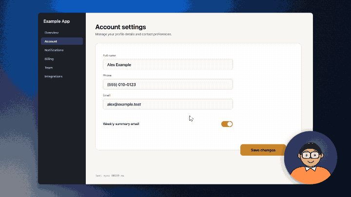
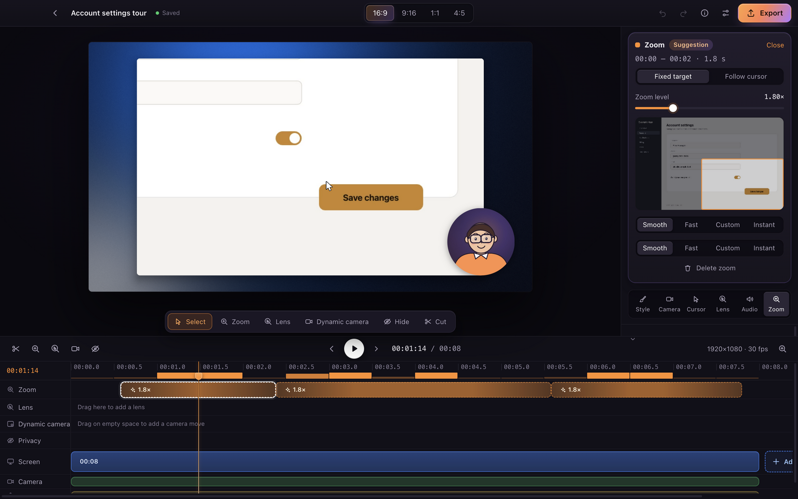
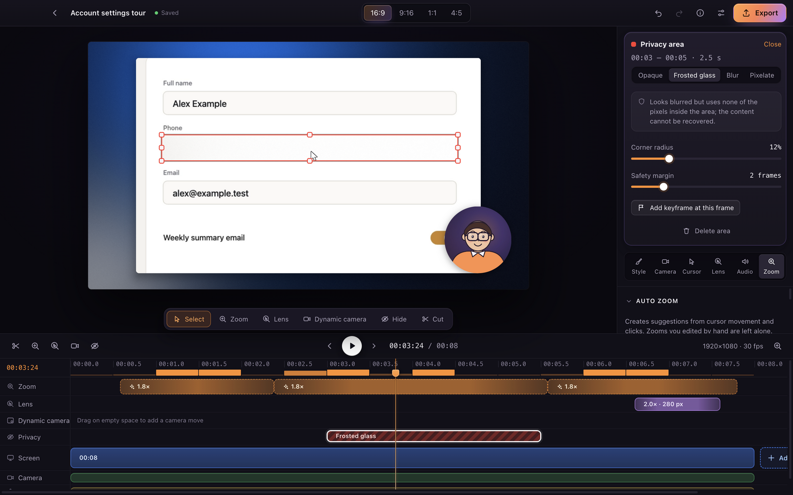
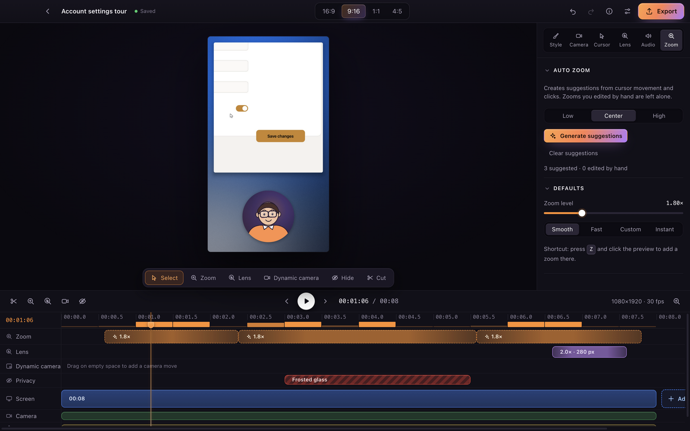
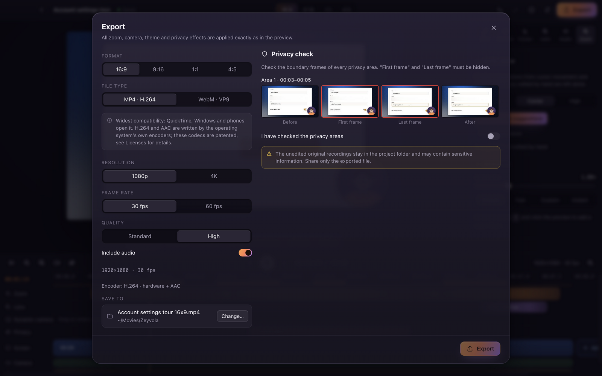
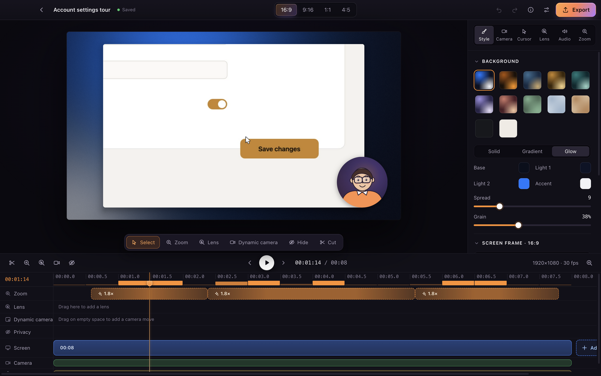
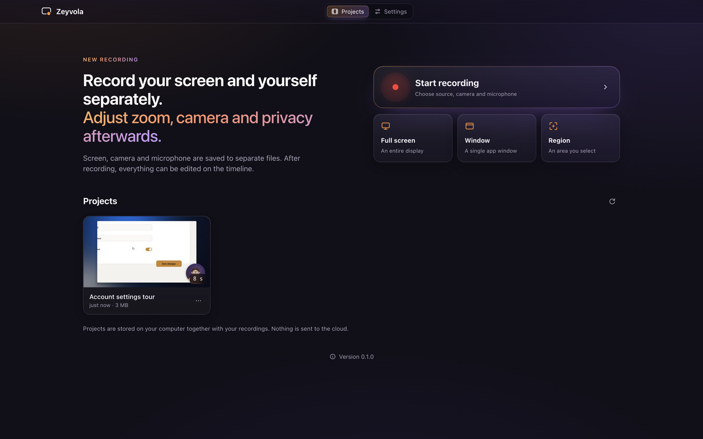

<p align="center">
  
</p>

<p align="center">
  <b>Record your screen, camera and microphone separately — then shape the video afterwards:<br>automatic zoom from your clicks, privacy masks, camera layout and vertical formats, all on your own computer.</b>
</p>

<p align="center">
  <a href="https://momotombo.dev"></a>
  <a href="https://momotombo.dev"></a>
  <a href="https://momotombo.dev"></a>
</p>

<p align="center">
  <sub>Version 0.1.0 · macOS 13+ (Apple silicon and Intel) · Windows 10 / 11 (64-bit)</sub>
</p>

| Computer                                  | Download                                                     |
| ----------------------------------------- | ------------------------------------------------------------ |
| Mac with Apple silicon (M1, M2, M3, M4 …) | [**Momotombo-0.1.0-macos-arm64.dmg**](https://momotombo.dev) |
| Mac with an Intel processor               | [**Momotombo-0.1.0-macos-x64.dmg**](https://momotombo.dev)   |
| Windows 10 / 11 (64-bit)                  | [**Momotombo-0.1.0-windows-x64.zip**](https://momotombo.dev) |

Which Mac? Apple menu › **About This Mac**: "Chip: Apple M…" → Apple silicon, "Processor: … Intel …" → Intel.

All files, checksums and the FFmpeg source package: [Releases](https://momotombo.dev). The app is not code-signed yet, so the first launch needs one extra click — see _Install_ below.

<p align="center">
  
</p>

<p align="center">
  
  <br><sub>Automatic zoom following a click</sub>
</p>

|                                                                        |                                                                             |
| ---------------------------------------------------------------------- | --------------------------------------------------------------------------- |
|  |     |
| _Zoom: suggested from your clicks, adjustable by hand_                 | _Privacy: frosted glass over sensitive data_                                |
|       |  |
| _One recording, several formats_                                       | _Export: MP4 or WebM, with a privacy check_                                 |

<details><summary>More screenshots</summary>


_The editor: automatic zoom suggestions on the timeline._


_Projects and quick start: full screen, window or region._

</details>

_Screenshots come from a made-up sample project; no real screen, person or camera picture is shown._

## Why Momotombo

- **Record once, decide later.** Screen, camera, microphone and system audio are recorded as separate tracks. Camera position and shape, zoom, background and format are all chosen after recording, on a timeline.
- **Zoom that follows your clicks.** Momotombo suggests zooms from where you clicked and where the pointer rested. Keep them, move them, or draw your own; your own zooms are never overwritten.
- **Privacy that holds.** Cover any area with frosted glass, blur, pixelation or an opaque box. Every exported frame goes through these effects, and the export window shows the first and last frame of each covered area so you can check them before saving.
- **A lens for the details.** The lens (magnifier) follows the pointer in the ranges you choose, with its own size and zoom; it never reveals a covered area.
- **One recording, many formats.** 16:9, 9:16, 1:1 and 4:5, each with its own framing, from the same project.
- **Standard files.** Export **MP4** (H.264 + AAC, written by the operating system's own encoder; opens in the players built into macOS and Windows) or **WebM** (VP9 + Opus), at 1080p or 4K, 30 or 60 fps.
- **Your recordings stay yours.** Projects and recordings stay on your computer. Momotombo makes no network requests, sends no telemetry and never records keystrokes.
- **Nothing lost to a crash.** If Momotombo or its recorder stops during a recording, the recording is added back to its project the next time Momotombo starts.
- **Spanish and English interface.** Spanish is the main language. It follows your computer's language on first launch; you can change it any time.

Also on the timeline: trim, split, add videos (MP4, MOV, WebM), markers during recording, pause and resume, camera moves over time, themes and backgrounds, undo and redo.

## What's in 0.1.0

- **macOS** (Apple silicon and Intel), macOS 13 Ventura or later. Recording uses Momotombo's macOS recording helper: system audio goes to its own track and the pointer is kept out of the video. The Intel package passed all of the app's own tests under Rosetta 2 on an Apple silicon Mac; it has not been tried on Intel hardware yet.
- **Windows 10 / 11** (64-bit). The automated tests passed on GitHub's Windows machine, and the app has been installed and used for recording on a real Windows PC. It has not been tried on every kind of hardware. On Windows, recording goes through the browser engine: system audio can be recorded and the pointer is part of the video.

Something not working? Please open an [Issue](https://momotombo.dev).

## Install

**macOS**

1. Open the `.dmg` and drag **Momotombo** onto the **Applications** shortcut.
2. Open Momotombo from **Applications**. Because it is not signed with an Apple Developer ID, macOS blocks the first launch:
   - **macOS 15 and later:** try to open it once and close the warning. Go to **System Settings › Privacy & Security**, click **Open Anyway** for Momotombo in the **Security** section and enter your login password. Apple shows this button for about an hour after the attempt.
   - **macOS 14 and earlier:** right-click (or Control-click) the app, choose **Open**, then **Open** again.

   This is needed on the first launch and may be needed again after downloading a new version.

**Windows**

1. Extract the `.zip` to a permanent folder (right-click › **Extract All**). Do not run the app from inside the zip.
2. Open `Momotombo\Momotombo.exe`.
3. Microsoft Defender SmartScreen may show **"Windows protected your PC"**: click **More info**, then **Run anyway**.
4. On first launch Momotombo asks you to accept Microsoft's terms for `d3dcompiler_47.dll`, a Microsoft graphics file included in the Windows version. The terms cover only that file and do not change Momotombo's license. **Read the terms** opens the full text. After **I accept**, Momotombo restarts once and does not ask again; after **I do not accept**, it quits and asks next time.

<details><summary><b>Windows notes</b></summary>

- **SmartScreen:** Momotombo is not code-signed, so SmartScreen warns on first launch. Company policy may block **Run anyway**.
- **Smart App Control:** If it is on in Windows 11 (Windows Security › App & browser control), Microsoft says it blocks unsigned apps and allows no exception for a single app, so Momotombo will not start. Turning it off is your decision and affects the whole computer.
- **Windows N editions:** They lack Microsoft's media components; MP4 export is expected to fall back to WebM (not tried yet). Add the **Media Feature Pack** under Settings › Apps › Optional features.
- **Computers without a hardware video decoder** (for example some virtual machines): imported H.264 videos (MP4, MOV) may not preview. Momotombo's own recordings are WebM and are not affected; a WebM copy of the video works.
- **The file `d3dcompiler_47.dll`** arrives as `d3dcompiler_47.dll.terms-pending` and gets its real name only after you accept the terms, so the app folder must be writable.

</details>

<details><summary><b>Permissions</b></summary>

**macOS** asks for each permission when it is first needed; you can change them in **System Settings › Privacy & Security**:

- **Screen & System Audio Recording** (**Screen Recording** on older macOS): for the screen and system audio. macOS asks on the first recording; quit and reopen Momotombo after allowing it.
- **Camera** and **Microphone**: when you use them in a recording. Their status is also shown, and can be requested, in Momotombo's **Settings**.
- The click helper watches only mouse buttons and scrolling. It needs no extra permission and does not read the keyboard.

Without a Developer ID signature, macOS may ask for screen recording again after an update. If it keeps an old entry and still blocks recording, remove the Momotombo row with "−", reopen Momotombo and allow it again; restart the Mac if needed.

**Windows** needs no separate permission for screen recording and clicks. If the camera or microphone does not work, allow desktop apps under **Settings › Privacy & security › Camera** (or **Microphone**); this applies to all desktop apps.

</details>

<details><summary><b>Uninstall</b></summary>

Removing the app does **not** delete your projects; delete them yourself if you want.

|                         | macOS                                               | Windows                                             |
| ----------------------- | --------------------------------------------------- | --------------------------------------------------- |
| App                     | Move `Momotombo` from **Applications** to the Trash | Delete the extracted folder (there is no installer) |
| Projects and recordings | `~/Movies/Proyectos Momotombo`                      | `Proyectos Momotombo` in your **Videos** folder     |
| Settings                | `~/Library/Application Support/Momotombo`           | `%APPDATA%\Momotombo`                               |

Exported videos stay where you saved them. On macOS you can also remove Momotombo's rows under **System Settings › Privacy & Security** with "−".

</details>

<details><summary><b>Troubleshooting</b></summary>

- **No "Open Anyway" button (macOS):** it appears for about an hour after you try to open the app. Try again, then return to **Privacy & Security**.
- **Recording does not start (macOS):** the screen recording permission is missing or went stale after an update; see _Permissions_.
- **MP4 export:** written with the operating system's encoder. On Windows without a hardware H.264 encoder, Windows' software encoder is used (slower); without that, the video is saved as WebM and Momotombo tells you before and after the export. WebM is always available.
- **Recording looks squeezed (Windows):** on some computers the screen arrives in a different shape. Momotombo shows it with the display's real shape and says so; one direction may have slightly less detail.
- **The app does not open (Windows):** Smart App Control may be on, or the app was started from inside the zip.
- **Check a download (optional):** compare it with `SHA256SUMS.txt` from the Release: `shasum -a 256 <file>` on macOS, `Get-FileHash <file>` in PowerShell.
- **To try it on a real Windows PC and report back:** [Windows test checklist](docs/windows-test-checklist.md).

</details>

## Privacy

Recordings, cursor data and projects stay on your computer. Momotombo makes no network requests and sends no telemetry. Keystrokes are not recorded. Clicks are stored locally only, for zoom suggestions.

## Developer

Momotombo is developed by **Momotombo Devs** · [momotombo.dev](https://momotombo.dev). Copyright © 2026 Momotombo Devs.

Momotombo is a modified version of Zeyvola and is not affiliated with the upstream project; see [`NOTICE`](NOTICE).

## License

Momotombo's source code is published under the **[PolyForm Shield License 1.0.0](LICENSE)**. It is a source-available license, not an open-source license in the OSI sense. The required notice lines are in [`NOTICE`](NOTICE).

In short (the license text governs; this summary adds nothing to it): individuals, companies and institutions may use, copy, modify and distribute Momotombo free of charge. The license claims no rights in the videos, recordings and projects you make with it and does not limit their commercial use. The one purpose it does not permit is providing a product that competes with Momotombo or with a product the licensor provides using it; under the license a product can compete even when it is free, and one marketed as a practical substitute for Momotombo definitely competes.

For the name and logo: [TRADEMARKS.md](TRADEMARKS.md).

## Third-party software

Momotombo is built on Electron (Chromium) and a few JavaScript packages, each under its own license.

- License texts: [docs/THIRD_PARTY_NOTICES.md](docs/THIRD_PARTY_NOTICES.md); in the app: **Settings › Licenses and third-party software**.
- FFmpeg (LGPL-2.1 or later): Electron's library built without proprietary codecs, shipped unchanged as a separate, dynamically linked file. The corresponding source is published with every release. You may replace the library with a compatible build and then re-sign the app.
- MP4 export writes H.264 video and AAC sound produced by the operating system's own encoders (macOS VideoToolbox and AudioToolbox, Windows Media Foundation), not by the app's code. No H.264 or AAC encoder is added to the app, and Electron's software H.264 encoder (OpenH264) is not used. On Windows without a hardware H.264 encoder, Windows' own software encoder is used (through `native/helper-windows`); otherwise the video is saved as WebM and the app says so.
- H.264 and AAC are patented codecs with royalty-bearing patent pools. How using the operating system's encoders affects those obligations is not legally settled, and this project gives no assurance about it. Details: [docs/THIRD_PARTY_NOTICES.md](docs/THIRD_PARTY_NOTICES.md) (codec table).
- WebM export uses VP9 + Opus. Their developers (Google, Xiph.Org) grant royalty-free licenses for their own patents; no assurance is given about third-party patent claims.

<details><summary><b>Building from source</b></summary>

Requirements: macOS (Apple silicon); Node.js 22.12+ (see `.nvmrc`; `nvm use` in the repository root); pnpm at the version in `packageManager` in `package.json`; Xcode Command Line Tools (`xcode-select --install`) — packaging, the native helpers and the audit tools call `swiftc`, `clang`, `codesign`, `lipo`, `otool`, `objdump`, `ditto`, `hdiutil` and `PlistBuddy`, and `pnpm start` signs the development bundle with `codesign`.

```bash
nvm use                       # Node version from .nvmrc
pnpm install
pnpm --filter @momotombo/desktop exec node node_modules/electron/install.js   # Electron binary
pnpm dev                      # build and open the app (pnpm build && pnpm start)
pnpm test && pnpm typecheck   # unit tests and type check
pnpm package                  # macOS package → apps/desktop/out/mp4/darwin-<arch>/
pnpm codec-audit -- apps/desktop/out/mp4/darwin-arm64 --profile mp4 --probe --release
```

`pnpm package` builds the published configuration by default (`MOMOTOMBO_DIST=mp4`: the macOS recording helper; MP4 as H.264 + AAC, WebM as VP9 + Opus). The helper is built as a universal binary (arm64 + x86_64) by `native/recorder-macos/build.sh`. `--profile webm` is the configuration without the helper, recording through the browser engine only. Packages are ad-hoc signed for local testing.

In-app test suites (temporary projects folder, synthetic camera and microphone; your own projects are never read; need a display and a GPU):

- `pnpm smoke`: builds the app and self-tests the renderer stack (WebGL2 compositor, privacy effects, WebCodecs encoders, MP4/WebM writers) and reports what this machine supports.
- `pnpm perftest`: times automatic zoom, playback and export.
- `pnpm uitest`: drives the main flow through the interface and also opens every exported MP4 with macOS's own decoder (AVFoundation).
- `node tests/media-check/av-check.mjs <file.mp4>`: checks an MP4 with AVFoundation (H.264 video, AAC sound, non-empty frames, duration).
- `pnpm docshots`: renders the README screenshots from the sample project.

Other notes:

- `tests/real-capture/` records the real screen; it needs the Swift compiler and the macOS screen recording permission and is not part of `pnpm test` (see [tests/real-capture/README.md](tests/real-capture/README.md)).
- `pnpm native:win` (Windows helper) needs the Zig compiler at `tools/.cache/zig/zig` or via `ZIG`; Zig is not in the repository.
- The app makes no network requests, but some build and release tools do: `pnpm install` and the Electron download, `tools/ffmpeg-source.mjs`, `tools/electron-artifacts.mjs` and `tools/zig-fetch.mjs`.

Structure:

- `apps/desktop`: Electron main process, preload and React interface
- `packages/timing`: tick-based time
- `packages/project-model`: document schema, commands, undo/redo, `evaluate()`
- `packages/zoom-engine`: automatic zoom suggestions
- `packages/compositor`: WebGL2 renderer (preview and export)
- `packages/media-web`: MP4 and WebM writers
- `packages/protocol`: IPC contract and validation
- `native/input-macos`: click helper (mouse buttons and scrolling; no codecs)
- `native/recorder-macos`: macOS recording helper (ScreenCaptureKit; screen and camera as H.264 through macOS's encoder, sound as Opus)
- `native/helper-windows`: Windows helper (clicks, imported audio, Media Foundation MP4)
- `tools/`: license notices, codec audit, FFmpeg source package

</details>

## Contributing

Bug reports and suggestions are welcome as [Issues](https://momotombo.dev). Code contributions (pull requests) are not accepted for now. Security problems: see [SECURITY.md](SECURITY.md).
